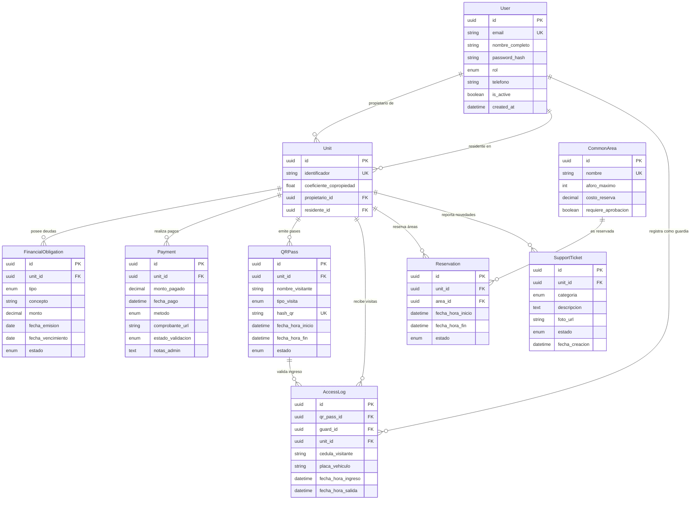

# Arquitectura Backend & API REST - App Conjunto Habitacional (SaaS)

Plataforma backend SaaS para la administración de condominios y conjuntos habitacionales (similar a Habitanto o Mi Casita), implementada en **Python**, **SQLAlchemy 2.0 (ORM)** y el framework **FastAPI**, con tipado estático (**Type Hints** y **Pydantic v2**), autenticación **JWT** y control de acceso basado en roles (**RBAC**).

---

## 🏛️ Estructura del Proyecto

```
App-Conjunto-Habitacional/
├── models.py          # Esquema relacional SQLAlchemy 2.0 (9 modelos con cascadas e índices)
├── database.py        # Configuración del motor relacional y dependencia get_db
├── security.py        # Hashing de contraseñas con bcrypt y generación/decodificación JWT
├── schemas.py         # Modelos Pydantic v2 para validación de entrada/salida
├── dependencies.py    # Inyección de dependencias RBAC (get_current_user, require_admin, etc.)
├── routers/
│   ├── __init__.py
│   ├── auth.py        # Endpoints /api/auth/login y /api/perfil
│   ├── units.py       # Endpoint /api/unidades (Solo Admin)
│   └── payments.py    # Endpoint /api/pagos (Solo Residentes)
├── main.py            # Servidor FastAPI, middleware CORS, lifespan y seed de datos iniciales
├── test_api.py        # Suite de pruebas automatizadas de integración y seguridad
└── README.md          # Documentación técnica
```

---

## 🔐 Capa de Seguridad y RBAC

### 1. Criptografía y JWT
- **Hashing**: Implementado con `bcrypt` (12 rondas de salting aleatorio).
- **Tokens JWT**: Firmados con algoritmo `HS256`, expiración configurable (por defecto 24 horas), transportando en el payload el `user_id` (`sub`) y el `rol` del usuario.

### 2. Matriz de Control de Acceso (RBAC)

| Endpoint | Método | Dependencia RBAC | Rol Permitido | Código de Error por Falta de Permiso |
| :--- | :---: | :--- | :--- | :---: |
| `/api/auth/login` | `POST` | *Público* | Cualquiera | `401 Unauthorized` |
| `/api/perfil` | `GET` | `get_current_user` | Autenticado (`ADMIN`, `RESIDENTE`, `GUARDIA`) | `401 Unauthorized` |
| `/api/unidades` | `GET` | `require_admin` | `ADMINISTRADOR` | `403 Forbidden` (*"Privilegios insuficientes"*) |
| `/api/pagos` | `POST` | `require_residente` | `RESIDENTE` | `403 Forbidden` (*"Privilegios insuficientes"*) |

---

## 🚀 Puesta en Marcha y Pruebas

### 1. Instalación de dependencias
```bash
# Con uv (recomendado)
uv venv
uv pip install fastapi uvicorn "pydantic[email]" pyjwt bcrypt passlib httpx pytest sqlalchemy
source .venv/bin/activate
```

### 2. Ejecutar Servidor de Desarrollo
```bash
python main.py
# La API se levantará en http://localhost:8000
# Documentación interactiva Swagger UI disponible en: http://localhost:8000/docs
```

Al iniciar por primera vez, el servidor sembrará automáticamente las siguientes cuentas de prueba:
- **Admin**: `admin@condominio.com` / `admin123`
- **Residente**: `laura@condominio.com` / `residente123`
- **Guardia**: `guardia@condominio.com` / `guardia123`

### 3. Ejecutar Suite de Pruebas
```bash
pytest -v test_api.py
```

---

## 📐 Diagrama Entidad-Relación (ERD)


