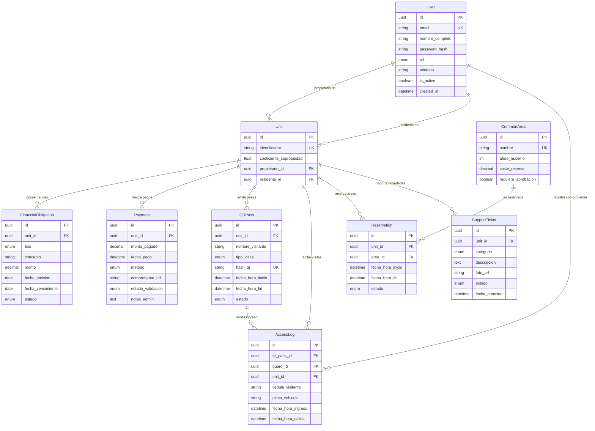

# Arquitectura de Datos - App Conjunto Habitacional (SaaS)

Esquema de base de datos relacional para plataforma SaaS de administración de condominios y conjuntos habitacionales (similar a Habitanto o Mi Casita), implementado en **Python** con **SQLAlchemy 2.0 (ORM)** y tipado estricto (**Type Hints**).

---

## 🏛️ Decisiones de Arquitectura

1. **SQLAlchemy 2.0 Moderno**:
   - Uso de `DeclarativeBase`, anotaciones `Mapped[...]` y constructores `mapped_column(...)`.
   - Compatibilidad completa con herramientas de análisis estático (`mypy`, `pyright`).

2. **Identificadores UUIDv4 Genéricos**:
   - Todas las tablas emplean `Uuid` (UUIDv4) como clave primaria.
   - Previene ataques de enumeración (IDOR) y facilita replicación y particionamiento en escenarios multi-inquilino (*multi-tenant*).

3. **Integridad Referencial y Cascadas Inteligentes**:
   - `ondelete="CASCADE"`: Si una `Unit` es eliminada, sus deudas, pagos, pases QR, tickets y reservas se limpian en cascada evitando registros huérfanos.
   - `ondelete="RESTRICT"`: Protege la propiedad legítima (`propietario_id`) y la autoría de registros en garita (`guard_id`).
   - `ondelete="SET NULL"`: Si un residente abandona la unidad o un pase QR expira/se elimina, el historial de accesos y la unidad vacante se preservan intactos para auditoría legal.

4. **Precisión Financiera**:
   - Campos monetarios (`monto`, `monto_pagado`, `costo_reserva`) modelados con `Numeric(10, 2)` mapeados a `Decimal` de Python para evitar errores de redondeo de punto flotante.

5. **Optimización con Índices B-Tree Estratégicos**:
   - Búsquedas O(1) de pases QR en garita mediante índice único en `hash_qr`.
   - Índices en `cedula_visitante` y `placa_vehiculo` para auditorías e investigaciones de seguridad.
   - Índices compuestos en `(area_id, fecha_hora_inicio, fecha_hora_fin)` para prevención de traslapes en reservas.
   - Filtros de cobranza indexados en `(unit_id, estado)` y `(fecha_vencimiento, estado)`.

---

## 📐 Diagrama Entidad-Relación (ERD)



---

## 🚀 Ejecución de Pruebas

Para verificar la creación de tablas, relaciones y consultas de prueba:

```bash
# Crear entorno virtual e instalar SQLAlchemy
uv venv
uv pip install sqlalchemy

# Ejecutar el script
python models.py
```
